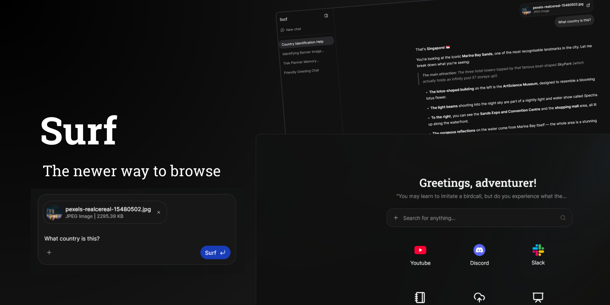
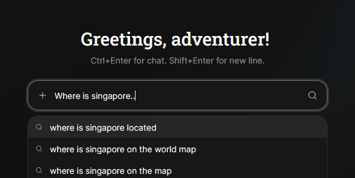
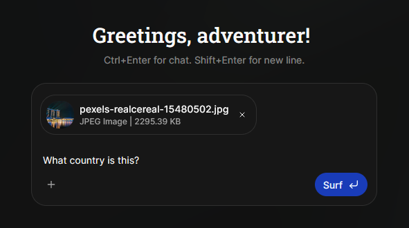
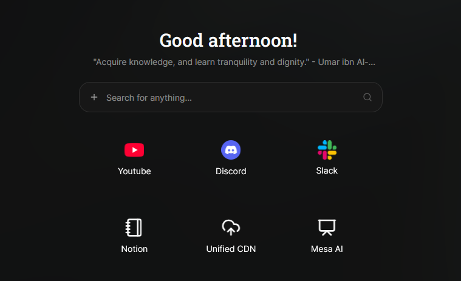

[<h1 align="center">Surf</h1>](https://surf.ngqian.com)
Surf is a concept new-tab page, with the idea of being clean and frictionless (hence surfing), while offering concise search results.

While originally meant to be a simple project, this site transformed into a way for me to test design skills and some cool design concepts! You must try all the goofy animations ;p

Visit it here: https://surf.ngqian.com.

## Features
### Hybrid Search bar
The search bar pulls up google autocomplete for quick results, then transforms into a chat prompt for longer queries. You can also use Ctrl+Enter to switch into chat mode manually.
| Normal search | With chat |
| :---: | :---: |
|  |  |

When you upload files, or ask longer more complex questions, you'll transform into the larger chat box without autocomplete. On clicking "Surf" or pressing enter, you'll be redirected to a chat page.

### Chat

The chat works like any typical chat app, but with a search tool to keep up to date. The model can search the web at will, giving accurate results (as if you were to search it up yourself) while making answers more targetted.

See a demo below:
[Insert demo vid later]

The chat page also has some ***sweet*** generating animations, that change depending if you're on dark or light mode (ugh)

*All chats are stored on-device in Indexed DB, and chats are routed to Hackclub AI.*

### Shortcuts
Shortcuts are just links on the new tab page, that can be created manually and sorted by dragging.

Currently, only web shortcuts are available, which redirect you to a different page. Shortcuts can also have 3 types of images: Website, Image or Icon.
- Website uses a favicon api to automatically fetch the favicon of the website you intend to redirect to.
- Image lets you upload any picture as the shortcut's glyph.
- Icon just gives you a list of Lucide icons to pick from

*(Try creating a shortcut! I spent quite some time tryna make the create shortcut dialog feel nice)*

Folders will be supported in a future ship :)

### Others
- Greeting that changes on every reload, with some different ones based on the time of day (e.g. Good morning, Burning the midnight oil?, Greeting adventurer)
- Quote API for some inspiration
- Calm but cool backgrounds on the homepage (interactive in light mode!)
- Sidebar for reference to past chats

## Technical stuff
### Why did I make it?
This was originally meant to be shipped as part of Stardance's new tab mission, but then I started added features and the hours just kept ballooning, so I decided to move it to Phantom instead.

Since Arc was discontinued, I migrated to it's successor, Dia. Dia's concept of the hybrid search bar was really unique to me, and I would really use it more if the chat wasn't so slow 😭.

So the inspiration for my new tab was to incorporate the core idea of a hybrid search bar, but make it much faster, and since it's a little side project I could be a little more creative and spend time on some details!

Every animation was carefully made and no AI was used for designing.

### How is it made?
Surf is made in Next.js (honestly it's just the framework im most used to for making anything nowadays), and uses Tailwind CSS along with ShadcnUI for styling.

Chats are stored using Dexie, a framework for making interacting with Indexed DB far easier, and work using the AI SDK from vercel and Hackclub AI.

Files are stored using [Unified CDN](https://github.com/ng-qi-an/unified-cdn), my other project!

Backgrounds and the little card tilt animation are from React bits, which make awesome microinterction examples and animated bgs.

